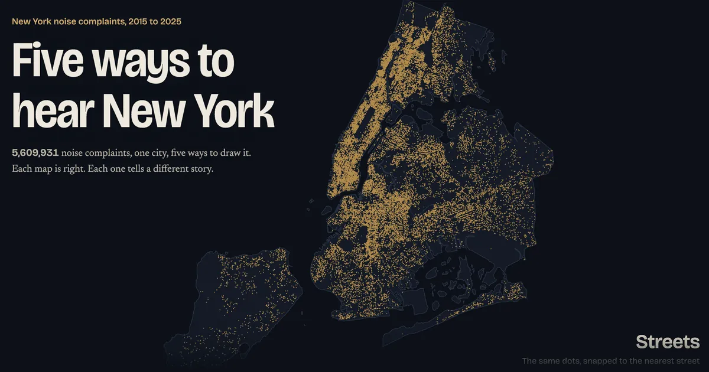
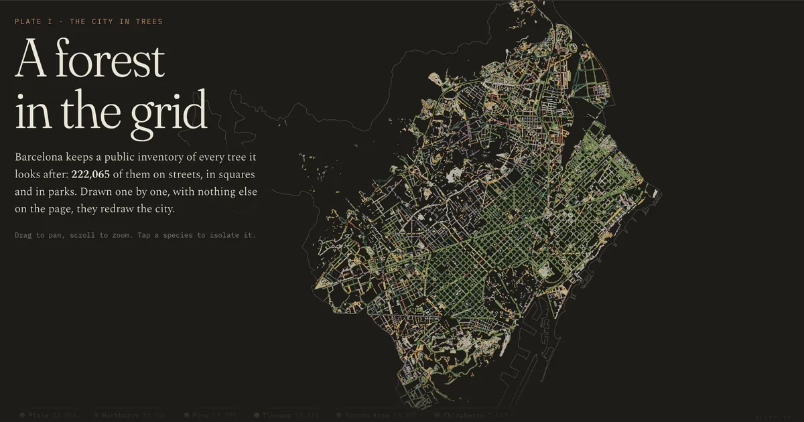
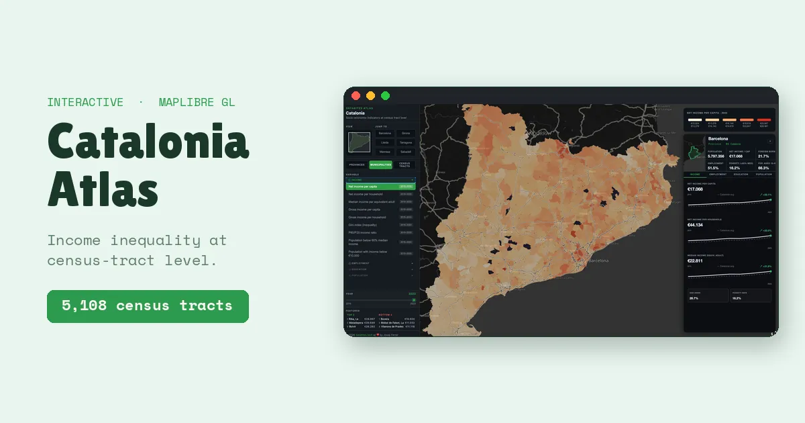
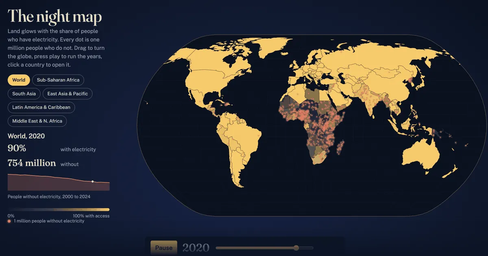
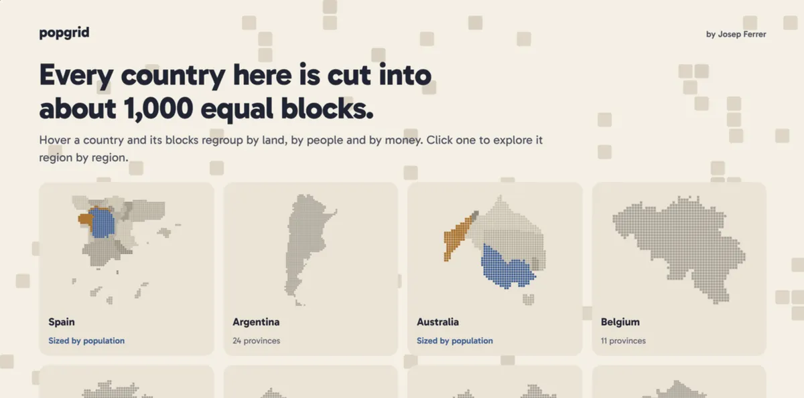
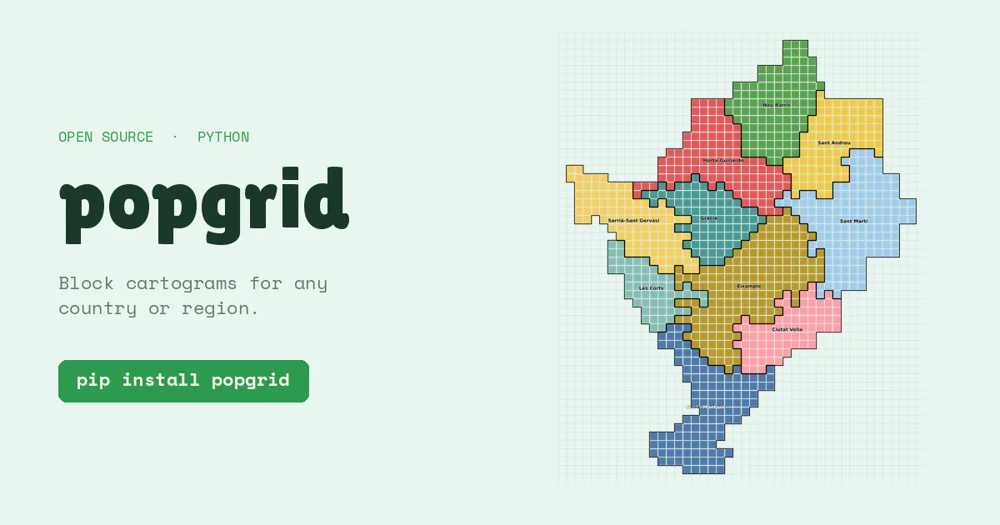

# data-storytelling

Interactive maps, explorers and data stories by [Josep Ferrer](https://databites.tech/gh). Every project here runs in the browser: click the image to open it, or follow the code link to see how it was built.

Looking for static charts and maps, including my #30DayMapChallenge? They're in **[dataviz](https://github.com/iamjosepferrer/dataviz)**.

## Interactive projects

| | |
|---|---|
| [](https://five-ways-nyc.databites.tech/) | **[Five ways to hear New York](https://five-ways-nyc.databites.tech/)** (2026)<br>One dataset, five maps. 5.6 million NYC 311 noise complaints from 2015 to 2025, drawn by street, by border, by hour, by change over time and all at once. Each map is right, and each one tells a different story.<br><sub>D3.js · Canvas · NYC 311 open data · [Code](https://github.com/iamjosepferrer/five-ways-nyc)</sub> |
| [](https://forest-in-the-grid.databites.tech/) | **[A forest in the grid](https://forest-in-the-grid.databites.tech/)** (2026)<br>Barcelona's public tree inventory, 222,065 trees, drawn one by one as a botanical atlas in five plates: the city in trees, six species, where the shade isn't, planting and felling, and climate shelters. In English, Spanish and Catalan.<br><sub>Canvas · Open Data BCN · [Code](https://github.com/iamjosepferrer/forest-in-the-grid)</sub> |
| [](https://catalonia-atlas.databites.tech/) | **[Catalonia Income Atlas](https://catalonia-atlas.databites.tech/)** (2025)<br>Income inequality across 5,108 census tracts, 947 municipalities and 4 provinces in Catalonia, with INE data from 2015 to 2023.<br><sub>MapLibre GL · Python · GeoJSON · [Code](https://github.com/iamjosepferrer/databites-atlas)</sub> |
| [](https://after-the-lights.databites.tech/) | **[After the lights came on](https://after-the-lights.databites.tech/)** (2026)<br>Since 2000, the number of people without electricity has halved. Did schooling and health follow? A night map where land glows with access and every dot is a million people without it, 2000 to 2024, plus a country-by-country explorer.<br><sub>D3.js · TopoJSON · UN Data Commons · [Code](https://github.com/iamjosepferrer/after-the-lights)</sub> |
| [](https://popgrid.databites.tech/) | **[popgrid explorer](https://popgrid.databites.tech/)** (2026)<br>Every country cut into 1,000 equal blocks. Switch between land, population and GDP and watch each region take the share it owns. 24 countries, built with popgrid.<br><sub>Canvas · [popgrid](https://github.com/databites-tech/popgrid)</sub> |

## Open-source tools

| | |
|---|---|
| [](https://github.com/databites-tech/popgrid) | **[popgrid](https://github.com/databites-tech/popgrid)**<br>A Python library that turns any country or region into a block cartogram, where every block is an equal share of land, population or GDP. It powers the popgrid explorer and my GDP maps in [dataviz](https://github.com/iamjosepferrer/dataviz).<br><sub>`pip install popgrid`</sub> |

## Newsletter data stories

Stories published in my newsletter, [databites](https://reads.databites.tech), with the analysis behind them in [`stories/`](stories). Each notebook fetches the data from the source API, caches it, runs the analysis and exports the chart-ready CSVs used for the Datawrapper charts.

| # | Story | Data source | Published |
|---|-------|-------------|-----------|
| 01 | [Europe's renewable energy divide is getting wider, not narrower](https://reads.databites.tech/p/europes-renewable-energy-divide-is) ([analysis](stories/the_green_divide)) | Eurostat `nrg_ind_ren`, 2004 to 2024 | May 2026 |
| 02 | [Europe's tourist nights hit a record in 2024](https://reads.databites.tech/p/europes-tourist-nights-hit-a-record) ([analysis](stories/tourism_nights_distribution)) | EU Tourism Dashboard `TOUR_NIGHT_SPENT`, 2019 to 2024 | May 2026 |

To rerun one:

```bash
pip install -r requirements.txt
jupyter lab stories/the_green_divide/renewable_analysis.ipynb
```

## Want one built on your data?

I make maps, explorers and data stories for public bodies, research groups and companies. **[Tell me what you need](https://databites.tech/gh)** and I reply within 2 business days.

## License

Code is under the [MIT License](LICENSE). Graphics are under [CC BY 4.0](https://creativecommons.org/licenses/by/4.0/): share them freely with credit to Josep Ferrer. Data keeps its original license.
